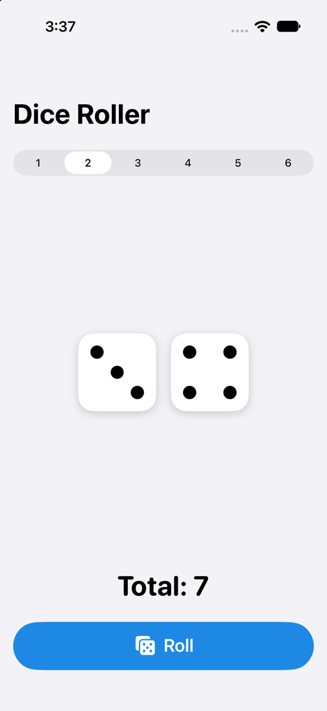

# Dice Roller

A small iPhone app made with SwiftUI. Pick one to six dice, tap Roll, and see the total. The last five rolls are listed at the bottom.

## Run it

1. Open `DiceRoller.xcodeproj` in Xcode.
2. Pick an iPhone simulator.
3. Press Run.

## What is inside

- `DiceRoller/DiceRollerApp.swift` starts the app.
- `DiceRoller/ContentView.swift` is the screen: the dice picker, the Roll button, the total and the history.
- `DiceRoller/DieView.swift` draws one die with its dots.
